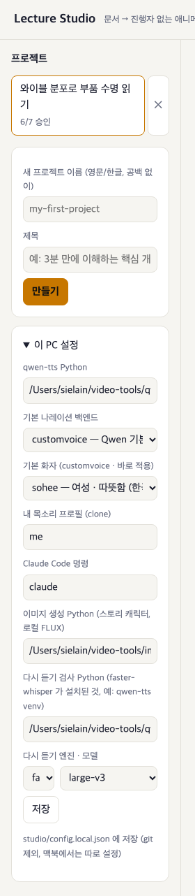
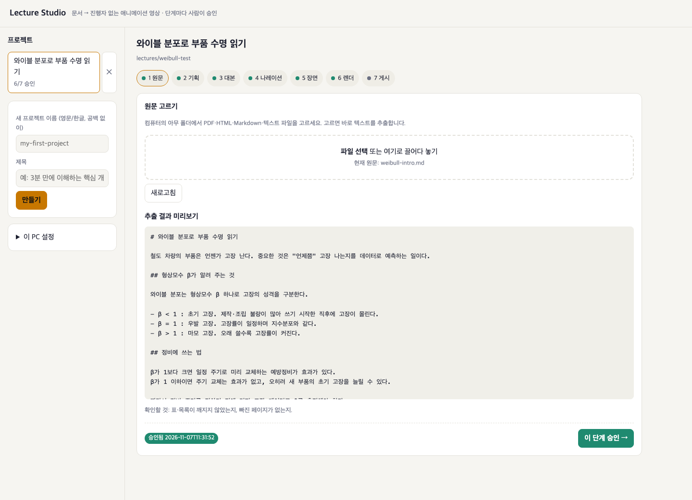
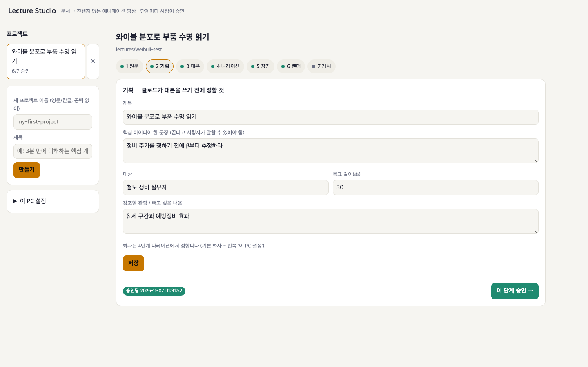
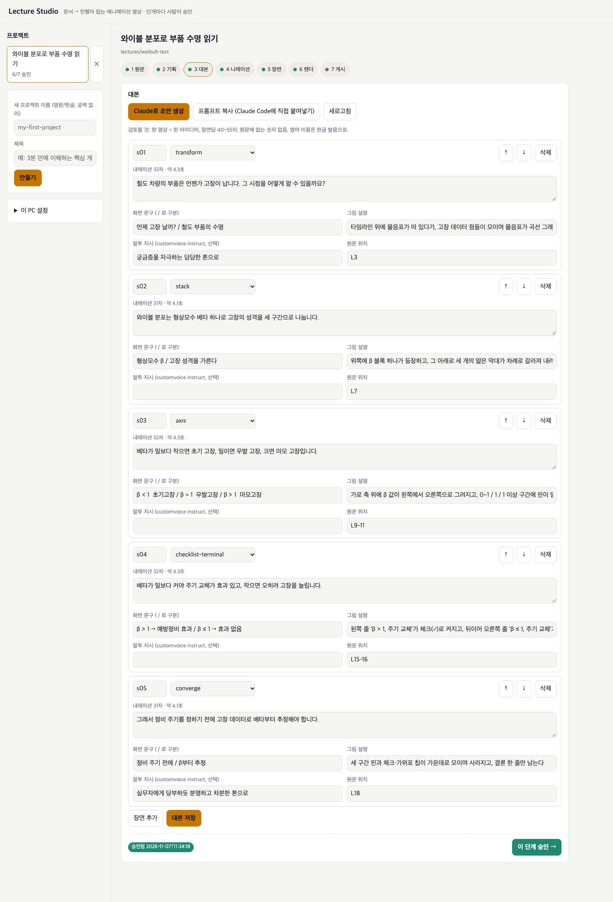
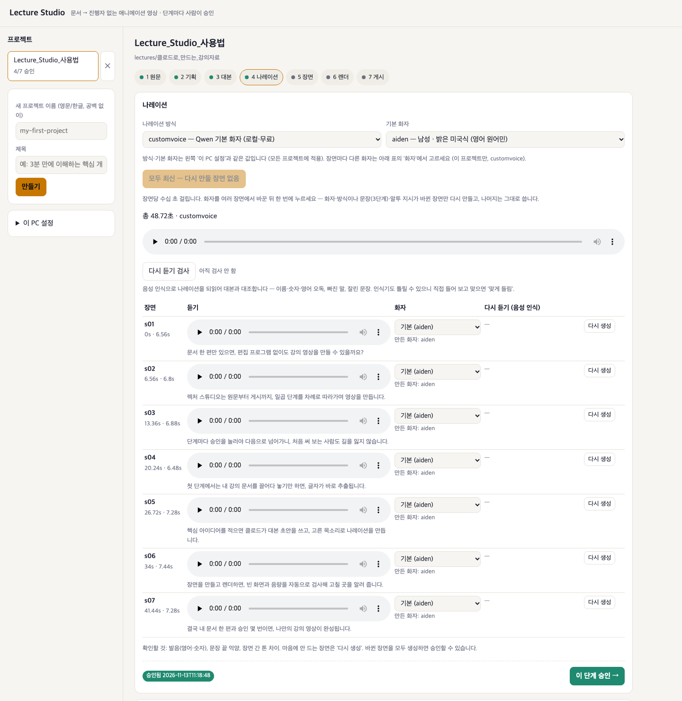
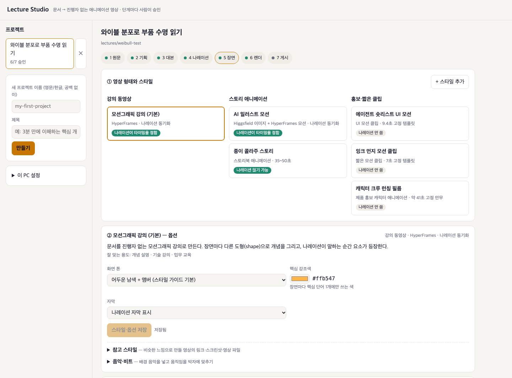
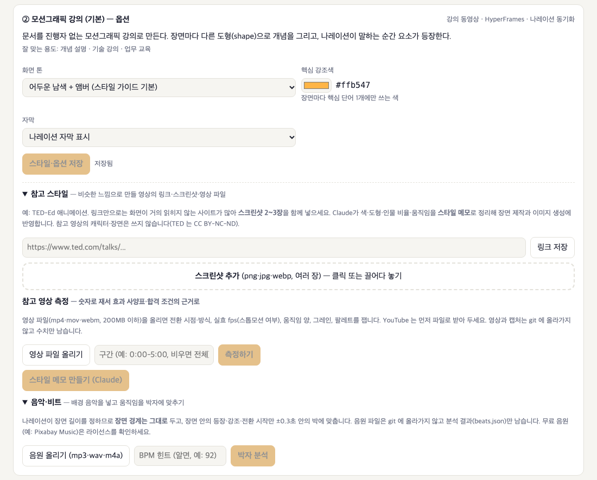
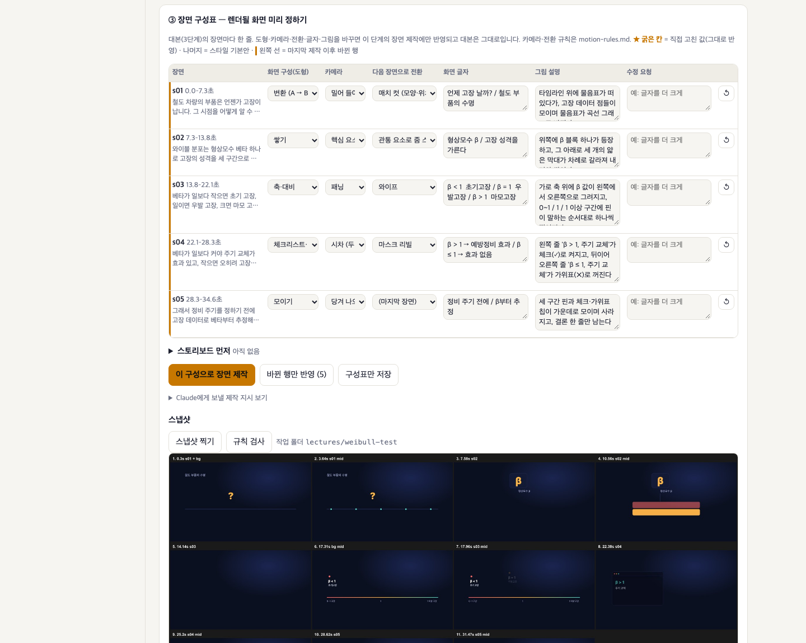
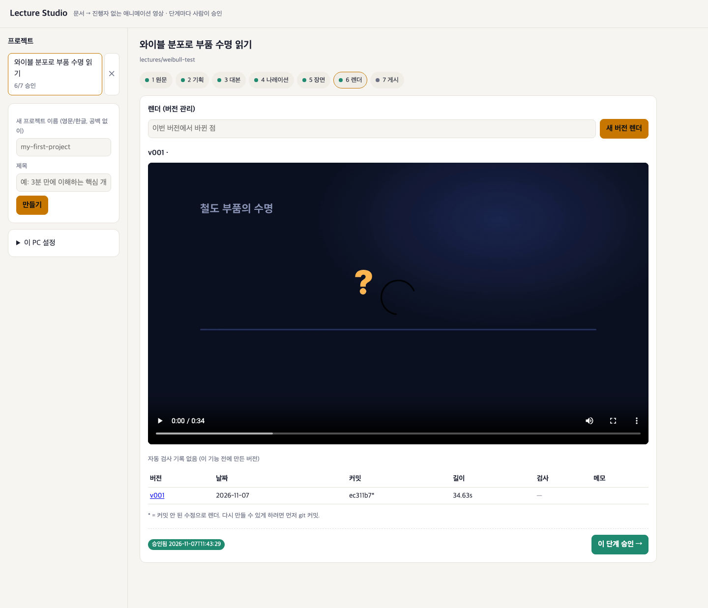
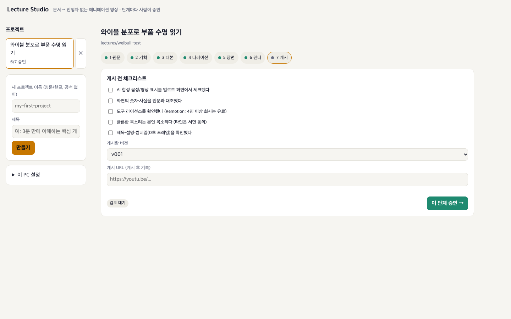

# Lecture Studio 사용법 (화면별)

`python3 studio/app.py` → http://127.0.0.1:8765 . 이 컴퓨터에서만 열립니다.
위쪽 단계 표시줄의 **1 원문 → 7 게시**를 차례로 진행하고, 단계마다 오른쪽 아래 **이 단계 승인 →** 을 눌러야 다음 단계가 확정됩니다.
앞 단계를 고치면 뒤 단계 승인은 "다시 승인 필요"로 바뀝니다. 점 색: 초록 = 승인됨, 빨강 = 수정됨·다시 승인 필요, 회색 = 대기. 지금 보고 있는 단계는 주황 테두리로 표시됩니다.

> 캡처는 2026-11-12 예시 프로젝트 `weibull-test`(와이블 분포로 부품 수명 읽기, 30초)입니다. 4단계 나레이션만 2026-11-13 화면 개편 뒤 `Lecture_Studio_사용법` 프로젝트로 다시 찍었습니다.

---

## 왼쪽 패널 — 프로젝트 · 이 PC 설정

- **프로젝트**: 목록을 눌러 열고, `×` 로 삭제합니다. 각 항목 아래에 `승인 n/7` 이 보입니다.
- **새 프로젝트**: 영문/한글 이름(공백 없음)과 제목을 넣고 **만들기**를 누릅니다.
- **이 PC 설정**(`studio/config.local.json`, git 제외, 기기마다 따로)
  - qwen-tts Python, 기본 나레이션 방식, **기본 화자**: 모든 프로젝트에 적용됩니다.
  - 내 목소리 프로필, Claude Code 명령, 이미지 생성 Python
  - **다시 듣기 검사 Python · 엔진 · 모델**: faster-whisper가 설치된 Python(qwen-tts 가상환경)을 지정합니다. 모델은 `small`(기본) 또는 `large-v3`(한국어가 더 정확함)입니다.

 

---

## 1 원문

- PDF·HTML·Markdown·텍스트 파일을 **선택하거나 끌어다 놓으면** 바로 텍스트를 추출합니다.
- **추출 결과 미리보기**에서 표·목록이 깨졌는지, 빠진 페이지가 없는지 확인한 뒤 승인합니다.

## 2 기획

- **제목 · 핵심 아이디어 한 문장**(끝나고 시청자가 말할 수 있어야 함) **· 대상 · 목표 길이(초) · 강조할 관점/뺄 내용**을 적고 **저장**합니다.
- 화자는 여기서 정하지 않고 4단계에서 정합니다.

## 3 대본

- **Claude로 초안 생성**: 원문과 기획을 바탕으로 장면(s01, s02…)을 만듭니다. Claude Code에 직접 넣으려면 **프롬프트 복사**를 누릅니다.
- 장면마다 **도형(transform·stack·axis…) · 나레이션 · 화면 문구(`/`로 줄 구분) · 그림 설명 · 말투 지시 · 원문 위치**를 고칩니다. `↑ ↓`로 순서를 바꾸고, 장면 추가·삭제를 한 뒤 **대본 저장**을 누릅니다.
- 검토 기준: 한 영상에 아이디어 하나, 장면당 40~55자, 원문에 없는 숫자는 넣지 않기, 영어 이름은 한글 발음으로.

## 4 나레이션

- **나레이션 방식**(Qwen 기본 화자 / Qwen 내 목소리 / Fish Audio 유료 / silent 시험용)과 **기본 화자**를 고릅니다. 둘 다 '이 PC 설정'과 같은 값입니다.
- **생성 버튼**: 다시 만들 장면 수와 이유를 보여 줍니다. 예: `생성 — 2개 장면 (화자 변경 1 · 문장 변경 1)`.
  - 화자·방식, 3단계 문장, 말투 지시가 바뀐 장면만 다시 만들고 나머지는 그대로 씁니다.
  - 처음에는 `전체 생성`, 바뀐 장면이 없으면 `모두 최신`(비활성)으로 표시됩니다.
  - 화자를 여러 장면에서 바꾼 뒤 한 번에 누르세요. 화자를 고르기만 해서는 생성되지 않습니다.
- **장면별 화자**: 표의 '화자' 칸에서 그 장면만 다른 목소리로 바꿉니다(이 프로젝트에만 적용). 다시 만들 장면에는 이유 배지가 붙습니다(예: `화자 변경 → 생성 시 다시 만듦`).
- **다시 생성**: 행마다 있는 버튼으로, 문장·화자가 같아도 그 장면만 새로 녹음합니다.
- **다시 듣기 검사**: 음성 인식으로 나레이션을 되읽어 대본과 대조합니다(이름·숫자·영어 오독, 빠진 말). 장면마다 `일치 n%` 배지가 붙습니다.
  - 검사에서 걸렸거나 글자 수에 비해 길이가 이상한 장면이 있으면 위쪽에 **걸린 장면 다시 생성 (n)** 버튼이 나타납니다.
  - 직접 들어 봐서 맞으면 **맞게 들림**을 누릅니다. 이 판정은 그 음성에만 유효합니다.
- **승인**: 장면별 판단은 없습니다. 바뀐 장면을 모두 생성해 나레이션이 현재 대본·화자와 맞으면 승인할 수 있습니다.
- **내 목소리 화자**: 녹음 파일(15~60초)을 올리고 본인 동의에 체크한 뒤 Fish Audio 화자(유료) 또는 로컬 Qwen 프로필(무료)을 만듭니다.

## 5 장면

### ① 영상 형태와 스타일

- 형태를 **강의 동영상 / 스토리 애니메이션 / 홍보·짧은 클립** 중에서 고르고 스타일 카드를 고릅니다. `나레이션이 타이밍을 정함` 배지가 붙은 스타일은 장면 길이를 나레이션이 결정합니다.
- **+ 스타일 추가**로 가져온 스킬을 스타일로 등록할 수 있습니다.

### ② 옵션 · 참고 스타일 · 참고 영상 측정 · 음악·비트

- 화면 톤, 핵심 강조색(장면마다 핵심 단어 1개에만 씀), 자막을 정하고 **스타일·옵션 저장**을 누릅니다.
- **참고 스타일**: 링크와 스크린샷 2~3장을 넣고 **스타일 메모 만들기 (Claude)** 를 누르면 색·도형·움직임이 메모로 정리돼 제작에 반영됩니다.
- **참고 영상 측정**: 영상 파일(200MB 이하)을 올리고 구간을 넣은 뒤 **측정하기**를 누릅니다.
  - 전환 시점·방식, 실제 fps(스톱모션 여부), 움직임 양, 그레인, 팔레트를 숫자로 잽니다. 이 값이 효과 사양표의 근거가 됩니다.
  - YouTube 영상은 먼저 파일로 받아 두세요. 영상은 git에 올라가지 않고 측정 수치만 남습니다.
- **음악·비트**: 음원을 올리면 BPM과 박을 분석합니다(BPM을 알면 힌트로 넣으세요). 장면 경계는 나레이션대로 두고, 장면 안의 등장·강조·전환 시작만 ±0.3초 안의 박에 맞춥니다.

### ③ 장면 구성표 · 스토리보드 · 제작 · 스냅샷

- **장면 구성표**: 장면마다 **화면 구성(도형) · 카메라 · 다음 장면으로 전환 · 화면 글자 · 그림 설명 · 수정 요청**을 정합니다. 직접 고친 칸에는 ★ 굵은 표시가 붙고, 마지막 제작 이후 바뀐 행은 왼쪽에 주황 선이 표시됩니다. 카메라·전환 규칙은 [motion-rules.md](../.claude/skills/edu-video/references/motion-rules.md)를 따릅니다.
- **스토리보드 먼저** → **스토리보드 만들기 (Claude)** 를 누르면 Claude가 계획서 `storyboard.md` 하나만 쓰고 멈춥니다.
  - 계획서에는 관통 요소, 장면표, 효과 파라미터, 에셋 계획, 예상 크레딧, 합격 조건이 들어갑니다. 유료 도구는 쓰지 않습니다.
  - 읽어 보고 **승인**하면 그대로 제작합니다. 오래 걸리거나 유료인 스타일은 이 단계를 권장합니다.
- **이 구성으로 장면 제작** / **바뀐 행만 반영 (n)** / **구성표만 저장**을 고릅니다. **Claude에게 보낼 제작 지시 보기**로 실제 지시문을 확인할 수 있습니다.
- **스냅샷 찍기**로 시간대별 프레임을 보고, **규칙 검사**로 연출 규칙 위반을 확인합니다.

## 6 렌더

- **이번 버전에서 바뀐 점**을 적고 **새 버전 렌더**를 누르면 `renders/v00n_날짜_커밋.mp4` 가 생기고 아래 표에 기록됩니다(커밋 옆 `*` = 커밋 안 한 수정으로 렌더).
- 렌더할 때마다 자동으로 처리되는 것:
  - 음량을 **−14 LUFS로 정규화**합니다.
  - **자동 검사**(빈 화면·멈춤·음량·읽기 시간)를 돌려 통과(초록) / 확인(주황) / 문제(빨강) 배지를 붙입니다.
  - 참고 영상 측정이 있으면 같은 코드로 재서 **±20% 대조**하고, 음원이 있으면 **박자 검사**를 합니다.
- 캡처 속 v001은 이 기능이 생기기 전에 만든 버전이라 "자동 검사 기록 없음"으로 나옵니다.

## 7 게시

- 다섯 가지를 모두 체크해야 승인됩니다.
  - AI 합성 음성·영상 표시
  - 화면의 숫자·사실을 원문과 대조
  - 도구 라이선스 확인(Remotion은 4인 이상 회사면 유료)
  - 클론한 목소리가 본인 목소리인지 확인
  - 제목·설명·썸네일(0초 프레임) 확인
- **게시할 버전**을 고르고, 올린 뒤 **게시 URL**을 기록합니다.

---

### 명령줄에서 쓰기

같은 기능은 명령줄에서도 쓸 수 있습니다. 명령은 [README](../README.md) 표에 있습니다. Studio 밖, 다른 프로젝트에서는 전역 스킬 [motion-video](../skills/motion-video/SKILL.md)가 같은 절차(측정 → 스토리보드 승인 → 제작 → 같은 코드로 검수)를 따릅니다.
